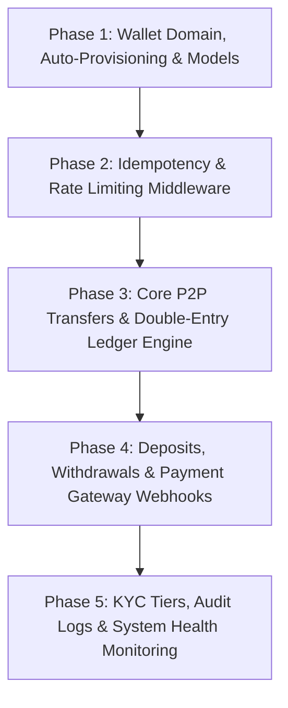

# Digital Wallet & P2P Transfer Fintech System: Implementation Plan

## Architectural Overview & Global Fintech Best Practices

This system follows **global financial software engineering standards** used by platforms like Revolut, Wise, and Stripe:

1. **Automatic Wallet Provisioning**: A primary wallet with a unique 10-digit Account Number (e.g., `ACC-8492049102`) is automatically created for every user upon email verification/registration.
2. **Defense-in-Depth (6-Digit Security PIN)**: Outbound transfers require a **6-digit Transaction PIN** (hashed securely with bcrypt). A compromised JWT token alone cannot drain funds.
3. **Double-Entry Bookkeeping**: Every transaction generates balanced `DEBIT` and `CREDIT` ledger entries. Financial integrity dictates that total debits equal total credits (`DEBIT + CREDIT = 0`).
4. **Exact Decimal Financial Math**: Uses PostgreSQL `DECIMAL(18, 4)` and Python `Decimal` to eliminate floating-point precision errors.
5. **Concurrency Control (Row-Level Locking)**: Money transfer transactions execute `SELECT ... FOR UPDATE` on sender & receiver wallet rows inside atomic SQL transactions to completely eliminate race conditions and double-spending.
6. **Network Idempotency**: Redis-backed `Idempotency-Key` header middleware guarantees that retried network requests (e.g. mobile reconnects) never execute a payment twice.

---

## Phased Implementation Roadmap

---

## Phase 1: Core Wallet Management & Models (STEP 1 - Immediate Focus)

#### [NEW] [app/models/wallet.py](file:///c:/Users/Morshed%20Nayeem/Desktop/Fintech%20FastAPI/Fintch%20Solution/app/models/wallet.py)
- **`Wallet` Model**:
  - `id`: UUID (Primary Key)
  - `user_id`: UUID (FK to `users.id`, Unique)
  - `account_number`: String(20) (Indexed, Unique 10-digit account number)
  - `balance`: `Numeric(18, 4)` (Default `0.0000`, non-negative constraint)
  - `currency`: String(3) (Default `"USD"`)
  - `status`: String(20) (Enum: `ACTIVE`, `FROZEN`, `CLOSED`)
  - `pin_hash`: String(255) (Nullable 6-digit PIN hash)
  - `created_at`, `updated_at`: DateTime
- **`Transaction` Model**:
  - `id`: UUID (Primary Key)
  - `reference_id`: String(50) (Unique transaction reference code e.g. `TXN-20260821-9X82F`)
  - `idempotency_key`: String(100) (Unique, Nullable)
  - `transaction_type`: String(30) (Enum: `P2P_TRANSFER`, `DEPOSIT`, `WITHDRAWAL`, `FEE`)
  - `status`: String(20) (Enum: `PENDING`, `COMPLETED`, `FAILED`)
  - `amount`: `Numeric(18, 4)`
  - `currency`: String(3)
  - `description`: String(255)
  - `created_at`: DateTime
- **`LedgerEntry` Model (Immutable Double-Entry Ledger)**:
  - `id`: UUID (Primary Key)
  - `transaction_id`: UUID (FK to `transactions.id`)
  - `wallet_id`: UUID (FK to `wallets.id`)
  - `entry_type`: String(10) (Enum: `DEBIT`, `CREDIT`)
  - `amount`: `Numeric(18, 4)` (Negative for DEBIT, Positive for CREDIT)
  - `balance_after`: `Numeric(18, 4)`
  - `created_at`: DateTime

#### [NEW] [app/schemas/wallet.py](file:///c:/Users/Morshed%20Nayeem/Desktop/Fintech%20FastAPI/Fintch%20Solution/app/schemas/wallet.py)
- `WalletResponse`: Account details, balance, status, currency, whether transaction PIN is set.
- `SetPinRequest`: 6-digit numerical PIN confirmation.
- `VerifyPinRequest`: PIN validation schema.

#### [MODIFY] [app/services/auth.py](file:///c:/Users/Morshed%20Nayeem/Desktop/Fintech%20FastAPI/Fintch%20Solution/app/services/auth.py)
- Integrate automatic wallet creation into `verify_otp` / user activation so every verified user instantly gets a primary USD wallet.

#### [NEW] [app/services/wallet.py](file:///c:/Users/Morshed%20Nayeem/Desktop/Fintech%20FastAPI/Fintch%20Solution/app/services/wallet.py)
- Account number generation utility (`ACC-XXXX...`).
- `create_user_wallet()`, `get_wallet_by_user_id()`, `set_transaction_pin()`, `verify_transaction_pin()`.

#### [NEW] [app/api/v1/wallets.py](file:///c:/Users/Morshed%20Nayeem/Desktop/Fintech%20FastAPI/Fintch%20Solution/app/api/v1/wallets.py)
- `GET /api/v1/wallets/me` - Get current user's wallet details & balance.
- `POST /api/v1/wallets/pin` - Set or update 6-digit transaction PIN.

#### [NEW] [alembic/versions/create_wallet_tables.py](file:///c:/Users/Morshed%20Nayeem/Desktop/Fintech%20FastAPI/Fintch%20Solution/alembic/versions/)
- Alembic database migration script for `wallets`, `transactions`, and `ledger_entries` tables.

---

## Verification Plan

### Automated Verification
1. Execute DB migrations:
   `python -m alembic upgrade head`
2. Run unit tests for wallet creation, PIN setting, and hashing:
   `pytest`

### Manual Verification
1. Register and verify a new user via API (`/auth/register` and `/auth/verify-otp`).
2. Verify that `GET /api/v1/wallets/me` returns an active wallet with a unique 10-digit account number and zero balance.
3. Test `POST /api/v1/wallets/pin` to set a 6-digit PIN and verify validation rules.
